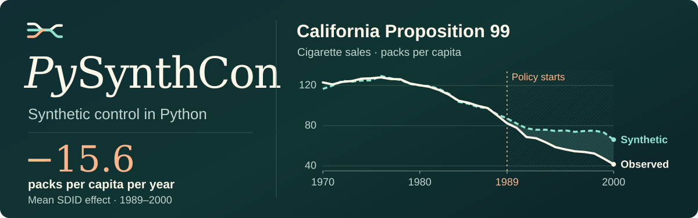

<h1 align="center">
  <a href="empirical_examples/california.ipynb">
    <picture>
      <source media="(max-width: 600px)" srcset="docs/assets/pysynthcon-header-compact.svg">
      
    </picture>
  </a>
</h1>

[](https://github.com/crahal/pysynthcon/actions/workflows/ci.yml)
[](pyproject.toml)
[](LICENSE)
[](docs/replication.md)

**[Quick start](#quick-start) · [Six worked examples](#six-worked-examples) · [Estimators](#estimators) · [Documentation](#documentation)**

PySynthCon lets you fit several synthetic controls to the same panel and see how the estimated effect changes with the method or donor pool. Compare held-out pretreatment predictions, refit after excluding donors, and put published benchmarks beside the estimates that reproduce them.

## Quick start

Install from source with Python 3.10 or newer. The distribution is `pysynth-control` and the Python import is `pysynth`.

```bash
git clone https://github.com/crahal/pysynthcon.git
cd pysynthcon
python -m venv .venv
source .venv/bin/activate  # Windows PowerShell: .venv\Scripts\Activate.ps1
python -m pip install -e ".[plot]"
```

California introduced its tobacco-control program in 1989. Use the same states and years to fit outcome-matching synthetic control (SCM) and synthetic difference-in-differences (SDID).

```python
from pysynth import SyntheticControl, SyntheticDID, compare, plot_effects, save_figure
from pysynth.datasets import DATASETS, load_dataset

panel = DATASETS["california"].panel(load_dataset("california"))
fits = {"SCM": SyntheticControl().fit(panel), "SDID": SyntheticDID().fit(panel)}

print(compare(fits)[["att", "pre_rmse"]])
fig, axes = plot_effects(fits, ylabel="Effect on sales (packs per capita)", xlabel="Year")
save_figure(fig, "outputs/custom/california-effects")
```

The SDID estimate is **−15.60 packs per capita per year**, averaged over 1989–2000. Effects are observed outcomes minus estimated untreated outcomes. The reference fit reports an iteration-limit warning for one set of weights and reproduces the original R estimate. [California notebook](empirical_examples/california.ipynb) · [SDID convergence and inference](docs/inference.md#handling-iteration-limit-warnings)

For your own data, `Panel.from_frame` takes unit, time and outcome columns, an explicit treatment date and an optional donor list. The treatment date is the first affected observation. Panels are balanced and use a common onset within each panel. ISC and 2SISC also accept case-specific panels and aggregate in event time. [Prepare a panel](docs/data.md)

## Six worked examples

| Open the notebook | What to look for |
| --- | --- |
| [California · tobacco control](empirical_examples/california.ipynb) | Recover the published SDID effect of −15.6 packs per person and SE of 8.4. With the original tobacco predictors, both R Synth and the Python optimizer rank California first of 39. Their year-2000 gaps are −25.43 and −24.46 packs. |
| [Basque Country · conflict](empirical_examples/basque.ipynb) | Recover the published SCM donor weights for Catalonia (0.8508) and Madrid (0.1492), and compare the GDP path with the original R fit. |
| [West Germany · reunification](empirical_examples/germany.ipynb) | Rebuild the historical predictor specification and compare the GDP gap with the paper’s roughly US$1,600 annual loss per person (1990–2003, PPP-adjusted). |
| [Kansas · tax cuts](empirical_examples/kansas.ipynb) | Match the authors’ ridge-augmented SCM vignette at −0.0401 log points and check all 16 quarterly effects. |
| [Rhode Island · decriminalization of indoor sex work](empirical_examples/rhode_island.ipynb) | Test a six-year effect path against every cyclic shift in time. Reproduce the joint p-value of 0.04 and the six annual pointwise confidence sets for female gonorrhea incidence. |
| [Simulation · donor spillovers](simulated_examples/donor_spillovers.ipynb) | Across 200 economies with a known +6-point effect, spillovers shift full-pool SCM by −2.78 points on average while its pretreatment fit stays identical. |

Four studies compare eleven estimators on a common panel. Rhode Island focuses on inference for outcome-matching SCM. All five empirical notebooks download hash-verified data into memory. Rhode Island and the simulation both run entirely in Python. The simulation generates its own data. Figures are embedded in the notebooks. Executing them also writes PDF, SVG, PNG and numerical tables under `outputs/empirical_examples/<study>/` or `outputs/simulated_examples/donor_spillovers/`. [Reference targets and tolerances](docs/replication.md) · [Figure exports](docs/plotting.md)

```bash
python -m pip install -e ".[notebooks]"
python scripts/execute_notebooks.py --examples rhode_island donor_spillovers
```

For all six notebooks, use Python 3.11 or 3.12, install the [pinned replication requirements](requirements-replication.txt) and provision the separately supplied local R reference bundle. SCUL and vanilla ISC use the original R backends. The California reassignment comparison also requires local R Synth 1.1-10 and the optional rpy2 bridge. Reproducing the California paper’s exact placebo sampling plan also uses the bundle. Once provisioned, `python scripts/execute_notebooks.py` runs all six. [Local R setup](docs/reference_backends.md)

## Estimators

| Method | Python interface | What determines the counterfactual |
| --- | --- | --- |
| Outcome-matching SCM | `SyntheticControl()` | Convex weights match the full pretreatment outcome path, with equal weight on each period. This is an outcome-only specification of [classical SCM](https://doi.org/10.1198/jasa.2009.ap08746). |
| Predictor-based SCM | `PredictorSyntheticControl()` | Convex weights balance predictors. Their relative importance can be fitted against pretreatment outcomes. [Abadie & Gardeazabal (2003)](https://doi.org/10.1257/000282803321455188) · [Abadie, Diamond & Hainmueller (2010)](https://doi.org/10.1198/jasa.2009.ap08746) |
| Ridge-augmented SCM | `AugmentedSyntheticControl()` | A ridge outcome model corrects residual imbalance. Donor weights can be negative. [Ben-Michael, Feller & Rothstein (2021)](https://doi.org/10.1080/01621459.2021.1929245) |
| Penalized SCM | `PenalizedSyntheticControl(lambda_=0.01)` | A pairwise penalty discourages weight on donors far from the treated unit in predictor space. [Abadie & L’Hour (2021)](https://doi.org/10.1080/01621459.2021.1971535) |
| Differenced SCM | `DifferencedSyntheticControl()` | Fit changes, then restore the average pretreatment level gap. The default uses zero pairwise penalty. [Engelbrektson (2021), working paper](https://arxiv.org/abs/2111.10784) |
| Robust SCM | `RobustSyntheticControl(lambda_=0.1, sv_count=3)` | Singular-value truncation denoises donor outcomes. Ridge weights fitted before treatment combine the denoised donor series. [Amjad, Shah & Shen (2018)](https://jmlr.org/papers/v19/17-777.html) |
| SCUL | `SCUL()` | Lasso with rolling-origin tuning, signed weights and an intercept. [Hollingsworth & Wing (2020)](https://doi.org/10.31235/osf.io/fc9xt) |
| Individual synthetic control | `IndividualSC()` | Fit each treated individual against the full eligible donor pool. [Vagni & Breen (2021)](https://academic.oup.com/esr/article/37/5/834/6325498) |
| Two-stage individual synthetic control | `TwoStageIndividualSC(n_neighbors=10)` | Screen the nearest donors on pretreatment features, then fit SCM in that group. [Petrillo et al. (2025)](https://eprints.whiterose.ac.uk/id/eprint/224118/1/Binder2025004.pdf) |
| Synthetic difference-in-differences | `SyntheticDID()` | Weight both donors and pretreatment periods. [Arkhangelsky et al. (2021)](https://doi.org/10.1257/aer.20190159) |
| Difference-in-differences | `DifferenceInDifferences()` | The comparison baseline uses uniform weights across donors and pretreatment periods. |

The penalty and rank values shown above are example choices. Install `python -m pip install -e ".[backends]"` for predictor-based, augmented, penalized and differenced SCM and the default 2SISC fit. [Method definitions and tuning](docs/methods.md) · [Implementation credits and backend details](docs/backends.md)

## Compare specifications

`select_estimator` scores each candidate on the same withheld pretreatment periods and refits the selected candidate on the full panel. `donor_sensitivity` refits after each donor exclusion. Pass named groups to examine a possible spillover region, as in the simulation.

```python
from pysynth import donor_sensitivity, select_estimator

candidates = {"SCM": SyntheticControl, "SDID": SyntheticDID}
selection = select_estimator(panel, candidates, initial_window=12, horizon=4)
print(selection.validation.summary)
print(donor_sensitivity(panel, candidates).summary)
```

`plot_comparison` aligns ATT estimates with pretreatment RMSE, and `plot_effects` preserves a common outcome scale across methods. Both return editable Matplotlib figures. [Evaluation guide](docs/evaluation.md) · [Plotting guide](docs/plotting.md)

## Is the effect unusual across units or across time?

Use state reassignments when the comparison is across units. When the question concerns the timing of a particular effect path, impose that path on the treated outcome and compare its residuals across time. The methods make different assumptions. [Inference guide](docs/inference.md)

```python
from pysynth import conformal_test
from pysynth.datasets import DATASETS, load_dataset

ri = DATASETS["rhode_island"].panel(load_dataset("rhode_island"))
test = conformal_test(ri, null_effect=0)
print(test.p_value)  # 0.04: one of 25 cyclic windows is at least as extreme
print(test.rotations.nlargest(3, "statistic"))
```

The Rhode Island notebook also tests each annual effect on the authors’ full grid. The spillover simulation applies the same sharp-path test to a known treatment effect and measures what happens when donors themselves respond to treatment. [Rhode Island replication](empirical_examples/rhode_island.ipynb) · [Spillover experiment](simulated_examples/donor_spillovers.ipynb)

## Documentation

- [Getting started](docs/getting-started.md) · [Data preparation](docs/data.md) · [API reference](docs/api.rst)
- [Research workflows](docs/differentiation.md) · [Inference](docs/inference.md) · [Estimator and replication audit](docs/audit.md)
- [Contributing and running tests](CONTRIBUTING.md) · [Changelog](CHANGELOG.md) · [Third-party notices](THIRD_PARTY_NOTICES.md)

When publishing, cite PySynthCon together with the method papers and upstream packages used in your analysis. [Software citation](CITATION.cff) · [Method references](docs/references.md)
